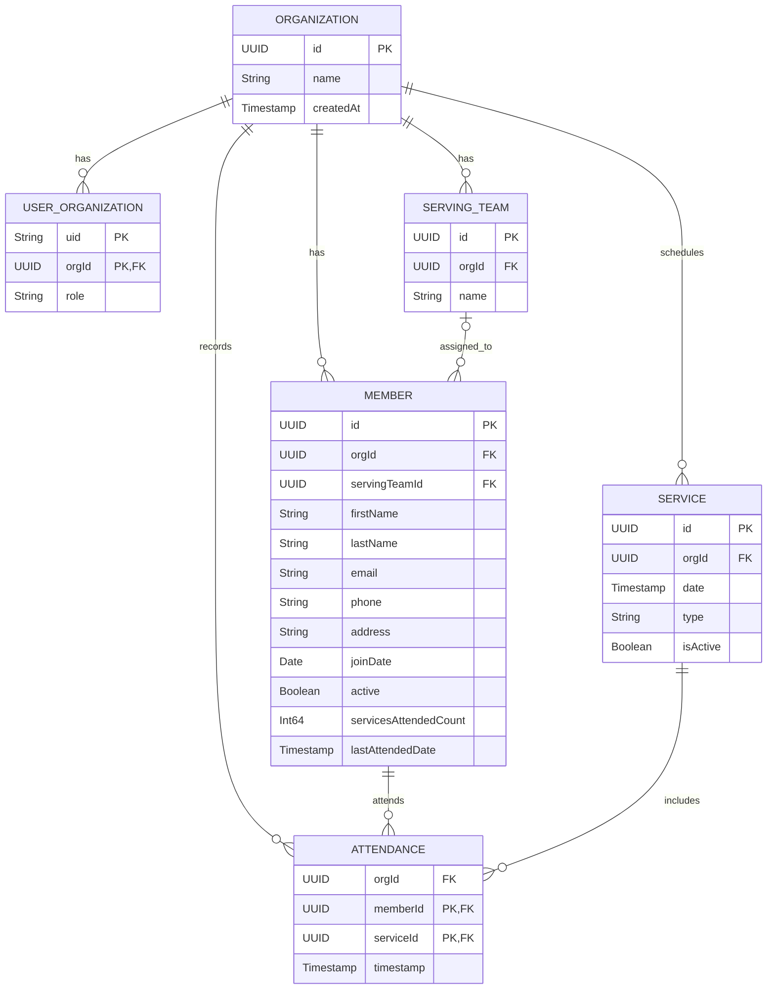

# AOG Manager

AOG Manager is a desktop application for managing church members, serving
teams, and service attendance. It runs with Electron and uses Firebase
Authentication for sign-in and Firebase SQL Connect for cloud data.

## What it does

- Sign in with a Firebase Authentication account.
- View and search members, filter by serving team, and add, edit, or remove
  member records.
- Refresh to fetch the latest member data from the database.
- Submit a service and select the members who attended. The app records each
  attendance and updates the member's attendance total.
- Support multiple organizations for an account, with organization access
  controlled by its membership.

Standard serving teams are General, Pastor, Youth Pastor, Worshiper, Usher,
Band, and Sound Team.

## Database structure

The database is relational. Firebase SQL Connect stores it in Cloud SQL for
PostgreSQL. The diagram below shows the main tables and relationships.



`USER_ORGANIZATION` connects a Firebase Auth user to an organization and
stores their role. A member can have an optional serving team. `ATTENDANCE`
uses the member and service together as its key, so the same member cannot be
recorded twice for one service.

## How attendance works

When an authorized user submits a service, the app saves the service, then
records each selected member's attendance. Each attendance record and its
member's attendance-count update are saved together in a database transaction.
If the connection interrupts the submission, the app can retry without
re-recording attendance that has already been saved.

SQL Connect operations check that the signed-in user belongs to the selected
organization. Changes to members, services, and attendance are restricted to
users with the `ADMIN` or `TEAM_LEAD` role.

## Run the application

From the project folder:

```powershell
npm install
npm start
```

Firebase Authentication, SQL Connect deployment, and first-organization setup
are required. Follow [FIREBASE_SETUP.md](FIREBASE_SETUP.md) for the full setup
instructions and deployment commands.

The main database definition is in
[dataconnect/schema/schema.gql](dataconnect/schema/schema.gql). SQL Connect
queries and mutations are in [dataconnect/connector](dataconnect/connector).
